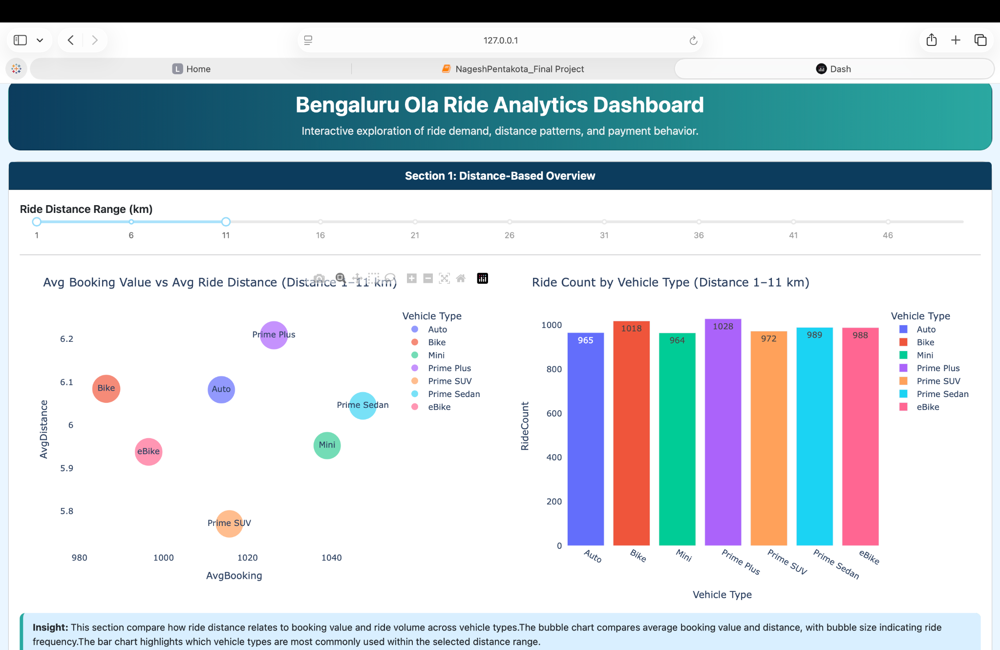
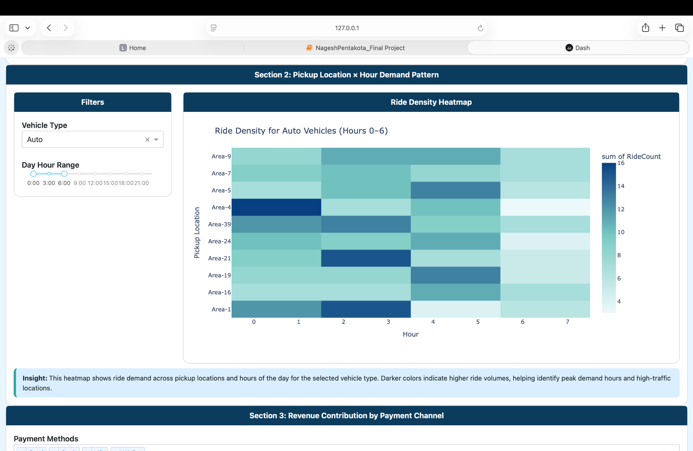
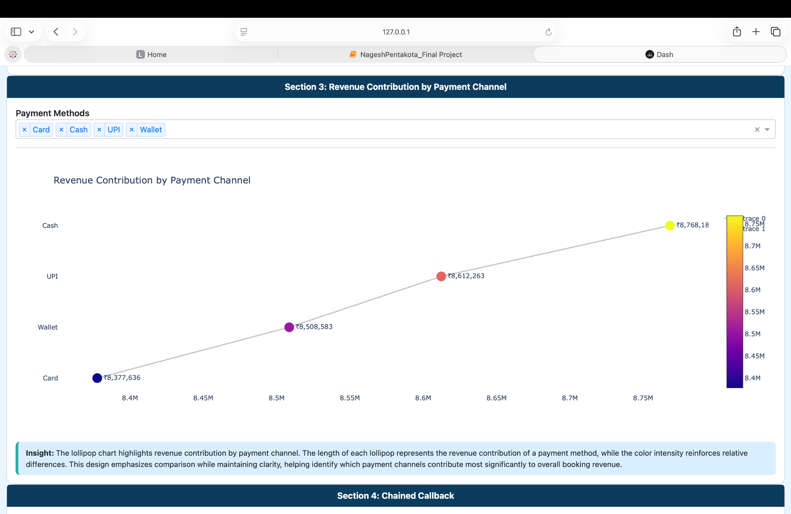
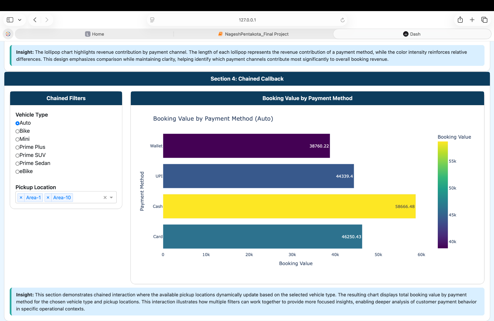

# Bengaluru Ola Ride Analytics Dashboard

An interactive **business intelligence and operational reporting dashboard** developed with Python, Dash, Plotly, and Pandas to explore ride demand, booking value, vehicle usage, pickup-location trends, and payment behavior.

## Dashboard previews

| Distance-based overview | Hourly pickup demand |
|---|---|
|  |  |

| Payment-channel revenue | Chained callback analysis |
|---|---|
|  |  |

## Features

1. **Distance-Based Overview:** Range slider filters ride distances; bubble chart compares average booking value, average distance, and ride count; bar chart compares ride volume by vehicle type.
2. **Pickup Location × Hour Demand:** Vehicle and hour filters update a heatmap of ride volume across pickup locations and hours.
3. **Revenue by Payment Channel:** Multi-select payment filter updates a comparative revenue visualization for Card, Cash, UPI, and Wallet.
4. **Chained Callback:** Selecting a vehicle type dynamically updates available pickup locations, which filter a horizontal booking-value chart by payment method.

The dashboard uses successful bookings for its analyses, with Pandas-based filtering and aggregation to calculate ride counts, average booking values, and payment-channel totals.

## Technology

- **Python and Pandas:** Data preparation, grouping, and aggregation
- **Dash and Dash Bootstrap Components:** Layout, controls, and reactive callbacks
- **Plotly:** Interactive visualizations
- **Excel / openpyxl:** Input dataset

## Run locally

Requires Python 3.10 or later.

```bash
python -m venv .venv
```

Activate the environment:

- macOS/Linux: `source .venv/bin/activate`
- Windows PowerShell: `.venv\Scripts\Activate.ps1`

Install dependencies and start the dashboard:

```bash
pip install -r requirements.txt
python app.py
```

Open **http://127.0.0.1:8050** in your browser. The Excel input is loaded from `data/Bengaluru Ola.xlsx` relative to the project folder.

## Repository contents

```text
bengaluru-ola-ride-analytics/
├── app.py                 # Standalone Dash application
├── requirements.txt       # Python dependencies
├── README.md              # Project documentation
├── .gitignore
├── data/
│   └── Bengaluru Ola.xlsx
├── notebooks/
│   └── NageshPentakota_Final_Project.ipynb
└── screenshots/
    ├── dashboard_section_1.png
    ├── dashboard_section_2.png
    ├── dashboard_section_3.png
    └── dashboard_section_4.png
```

## Notes

- This repository includes the Excel dataset supplied with the project. Verify that you have permission to publish it publicly before uploading.
- This is a local interactive dashboard; publishing the code to GitHub does **not** host a live website.
- The project is built with **Dash**, not Power BI; its transferable skills include dashboarding, data transformation, KPI calculations, and interactive reporting.

## Author

Nagesh Pentakota
